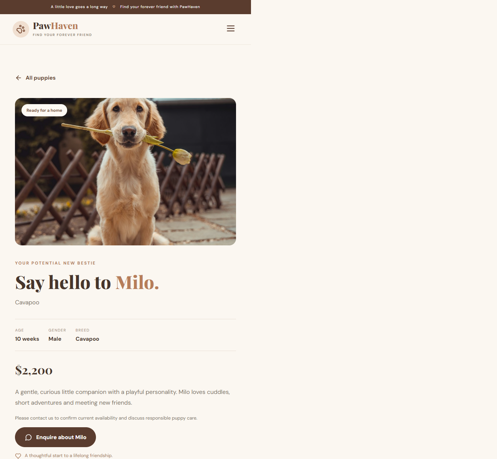
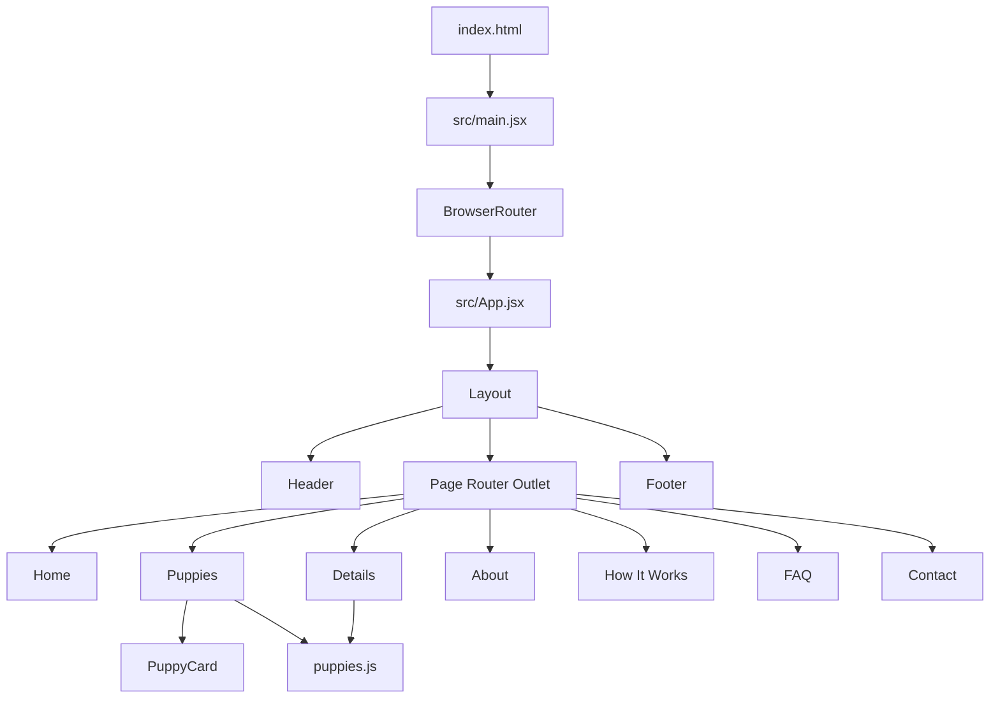

# PawHaven

PawHaven is a responsive puppy discovery website built with React and Vite. It provides a polished frontend experience for exploring a sample puppy catalogue, reviewing individual profiles, learning about the PawHaven story and submitting demo enquiries.


## Project Overview

PawHaven is a frontend-only demonstration. It does not include a database, authentication system, payment service, reservation service or email backend.

The application demonstrates:

- A responsive, animated marketing and puppy discovery interface
- Browser-side catalogue filtering and searching
- Dynamic puppy detail pages
- A demo contact form with HTML validation
- An enquiry modal that opens an email draft
- Shared navigation and footer layout
- Route-level page transitions
- Responsive desktop and mobile layouts

## Website Screenshots

### Puppy Catalogue

The catalogue supports text search and filters for breed, gender and maximum price.


### Puppy Details

Each catalogue entry has a dynamic details page with age, gender, breed, price and description.



### About PawHaven

The about page explains the purpose and wellbeing-focused philosophy of the website.


## Features

| Feature           | Description                                                                     |
| ----------------- | ------------------------------------------------------------------------------- |
| Home page         | Brand introduction, featured puppies, brand promise and call-to-action sections |
| Puppy catalogue   | Name/breed search, breed filter, gender filter and price filter                 |
| Puppy details     | Dynamic profile data selected from the puppy ID in the route                    |
| Enquiry flow      | Modal with a prefilled email enquiry link                                       |
| About page        | Project story and PawHaven philosophy                                           |
| How It Works page | Four-step puppy adoption journey                                                |
| FAQ page          | Expandable accordion questions                                                  |
| Contact page      | Browser-validated demo contact form                                             |
| Navigation        | Responsive header, active route links and mobile menu                           |
| Animation         | Page transitions and card hover animations                                      |

## Technology Stack

| Technology     | Purpose                                          |
| -------------- | ------------------------------------------------ |
| React 18       | Component-based user interface                   |
| React DOM      | Browser rendering                                |
| Vite           | Development server and production bundler        |
| React Router 6 | Client-side routing                              |
| Framer Motion  | Page and component animations                    |
| Lucide React   | Interface icons                                  |
| Custom CSS     | Layout, typography, responsive styling and theme |
| Prettier       | Consistent source formatting                     |

## Application Routes

| Route           | Page         | Responsibility                                                              |
| --------------- | ------------ | --------------------------------------------------------------------------- |
| `/`             | Home         | Hero, trust information, featured puppies, story and contact call-to-action |
| `/puppies`      | Puppies      | Catalogue search and filtering                                              |
| `/puppies/:id`  | Details      | Selected puppy profile and enquiry modal                                    |
| `/about`        | About        | PawHaven story                                                              |
| `/how-it-works` | How It Works | Puppy journey steps                                                         |
| `/faq`          | FAQ          | Frequently asked questions                                                  |
| `/contact`      | Contact      | Demo enquiry form                                                           |
| Unknown route   | Not Found    | Friendly fallback with a link back home                                     |

## Project Structure

```text
pawhaven/
├── docs/
│   └── screenshots/          # Live website screenshots used in documentation
├── src/
│   ├── components/
│   │   ├── layout/
│   │   │   ├── Header.jsx    # Announcement bar, brand and navigation
│   │   │   ├── Footer.jsx    # Contact, links and newsletter controls
│   │   │   └── Layout.jsx    # Shared header, outlet and footer shell
│   │   ├── CTA.jsx           # Reusable call-to-action section
│   │   ├── PuppyCard.jsx     # Puppy catalogue card
│   │   └── SectionTitle.jsx  # Standard section heading
│   ├── data/
│   │   └── puppies.js        # Demo puppy records
│   ├── pages/
│   │   ├── Home.jsx
│   │   ├── Puppies.jsx
│   │   ├── Details.jsx
│   │   ├── About.jsx
│   │   ├── HowItWorks.jsx
│   │   ├── FAQ.jsx
│   │   └── Contact.jsx
│   ├── App.jsx               # Route configuration and page transitions
│   ├── main.jsx              # React entry point
│   └── styles.css            # Complete responsive website theme
├── index.html                # HTML metadata and Google font setup
├── package.json              # Scripts and dependencies
├── package-lock.json         # Reproducible dependency versions
└── README.md
```

## Application Architecture



## Getting Started

### Requirements

- Node.js 18 or newer
- npm

### Install

```bash
npm install
```

### Start Development Server

```bash
npm run dev
```

Open the local address printed by Vite, normally:

```text
http://localhost:5173/
```

### Build for Production

```bash
npm run build
```

The production bundle is written to `dist/`.

### Preview the Production Build

```bash
npm run preview
```

### Format Source Files

```bash
npm run format
```

## Deploy to Vercel

1. Import the project into Vercel.
2. Vercel will detect the Vite framework.
3. Use the defaults from `vercel.json`:

   ```text
   Build command: npm run build
   Output directory: dist
   Install command: npm install
   ```

4. Deploy the project.

The included `vercel.json` rewrites all routes to `index.html` so React Router URLs such as `/puppies/p1` and `/about` work on direct visits and page refreshes.

## Deploy to Netlify

1. Import the project into Netlify.
2. Use the settings from `netlify.toml`:

   ```text
   Build command: npm run build
   Publish directory: dist
   ```

3. Deploy the project.

The included `netlify.toml` provides the Netlify redirect that serves `index.html` for React Router routes.

## Source Guide

### Routing

`src/App.jsx` contains all application routes. `src/components/layout/Layout.jsx` provides the shared header, main outlet and footer for every routed page.

### Puppy Data

`src/data/puppies.js` contains the six demo records. Each record has an ID, name, breed, age, gender, price, availability tag, image URL and description.

The catalogue uses `useMemo` to update results immediately when search or filter values change.

### Puppy Details

`src/pages/Details.jsx` reads the `id` parameter through `useParams()`, finds the matching record and renders that puppy's details. Unknown IDs display a not-found state.

### Shared Layout

The layout is divided between:

- `Header.jsx` for the announcement bar, brand and responsive navigation
- `Footer.jsx` for links, contact details, social placeholders and newsletter interaction
- `Layout.jsx` for combining shared layout with the active route

### Styling

`src/styles.css` contains the complete visual system, including:

- Color variables
- Typography
- Responsive breakpoints
- Header and navigation
- Hero and trust sections
- Puppy cards and catalogue controls
- Details and modal views
- FAQ accordion
- Contact form
- Footer

## Customization

### Change Brand Details

Update navigation, brand and footer content in:

- `src/components/layout/Header.jsx`
- `src/components/layout/Footer.jsx`

### Change Puppy Listings

Update or add records in `src/data/puppies.js`.

### Change Page Copy

Update the relevant files in `src/pages/`.

### Change Theme

Update CSS variables and component styles in `src/styles.css`.

### Change Page Metadata

Update title, description and font links in `index.html`.

## Demo Limitations

- Puppy information is illustrative and should not be treated as real availability.
- The contact form validates and resets in the browser but does not send or store data.
- The newsletter alert is a local demonstration and is not connected to an email provider.
- Enquiry actions open a `mailto:` draft for `hello@pawhaven.example`.
- Instagram and Facebook links are placeholders.
- Email and telephone values contain example placeholders.
- Puppy and atmosphere photographs are loaded from Unsplash and require internet access.
- No reservation, payment or inventory API is configured.

## Before Deployment

Replace the placeholder content in the source:

1. Replace `hello@pawhaven.example`
2. Replace `+1 (000) 000-0000`
3. Replace social placeholder URLs
4. Replace sample puppy records with licensed and verified data
5. Replace Unsplash images with approved local or hosted images
6. Connect the contact and newsletter forms to real services
7. Add secure reservation and payment services if required
