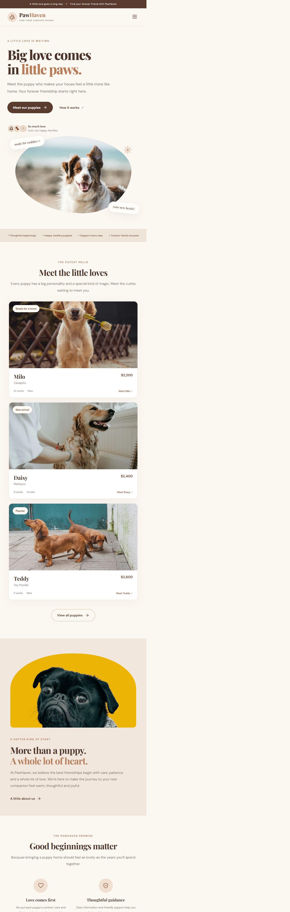
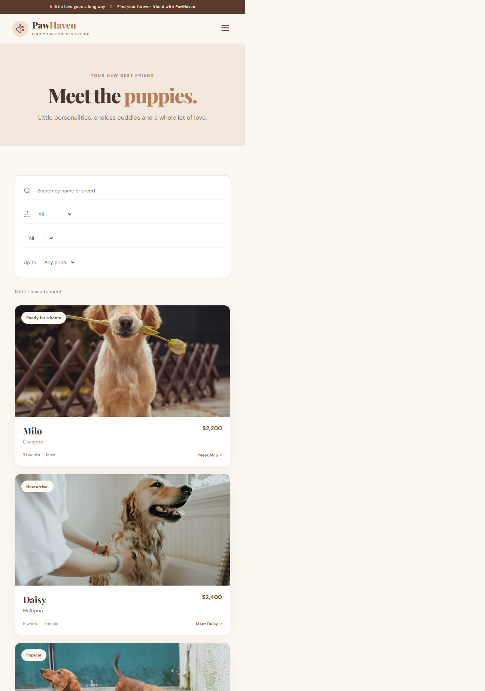
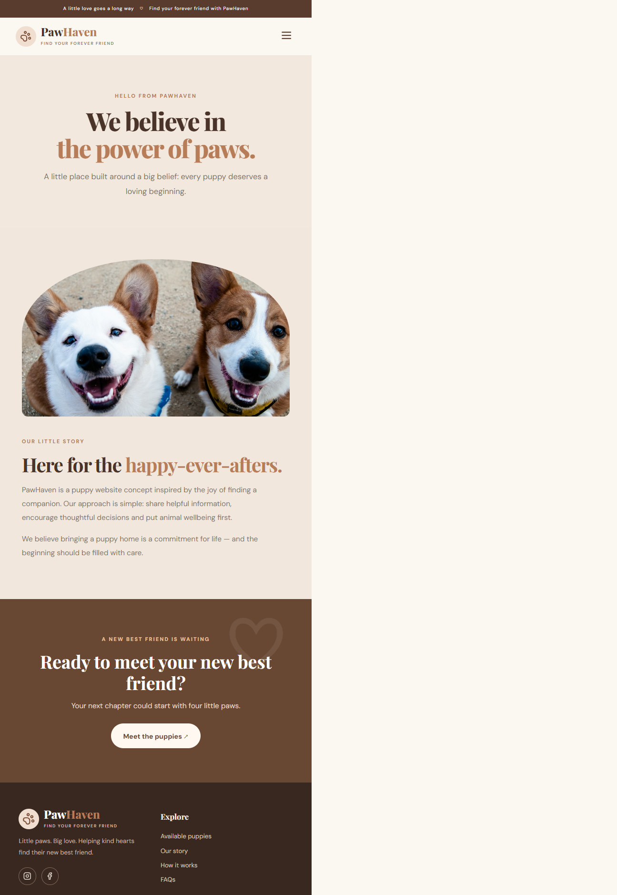
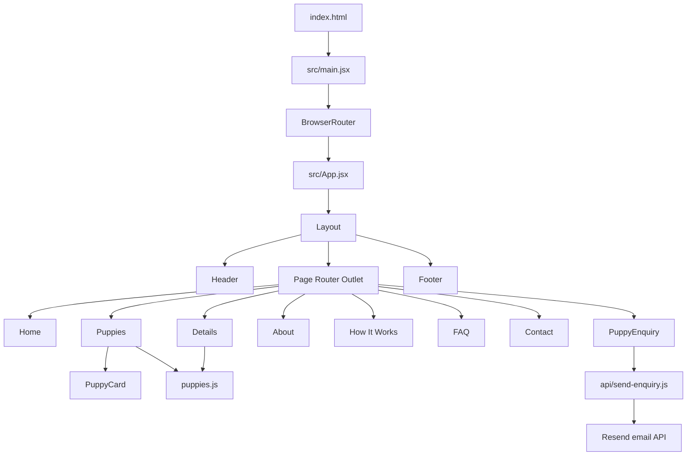

# PawHaven

PawHaven is a responsive puppy discovery website built with React and Vite. It provides a polished experience for exploring a sample puppy catalogue, reviewing individual profiles, learning about the PawHaven story and submitting puppy enquiries.



## Project Overview

PawHaven is a frontend demonstration with a Vercel serverless function for puppy enquiries. It does not include a database, authentication system, payment service or reservation service.

The application demonstrates:

- A responsive, animated marketing and puppy discovery interface
- Browser-side catalogue filtering and searching
- Dynamic puppy detail pages
- A demo contact form with HTML validation
- Puppy-specific enquiry forms delivered through Resend, plus WhatsApp enquiries
- Shared navigation and footer layout
- Route-level page transitions
- Responsive desktop and mobile layouts

## Website Screenshots

### Puppy Catalogue

The catalogue supports text search and filters for breed and gender. Puppy prices are not displayed.



### Puppy Details

Each catalogue entry has a dynamic details page with age, gender, breed and description.


### About PawHaven

The about page explains the purpose and wellbeing-focused philosophy of the website.



## Features

| Feature           | Description                                                                     |
| ----------------- | ------------------------------------------------------------------------------- |
| Home page         | Brand introduction, featured puppies, brand promise and call-to-action sections |
| Puppy catalogue   | Name/breed search and filters for breed and gender                              |
| Puppy details     | Dynamic profile data selected from the puppy ID in the route                    |
| Enquiry flow      | Puppy-specific form emailed to PawHaven or a prefilled WhatsApp chat            |
| About page        | Project story and PawHaven philosophy                                           |
| How It Works page | Four-step puppy adoption journey                                                |
| FAQ page          | Expandable accordion questions                                                  |
| Contact page      | Browser-validated demo contact form                                             |
| Navigation        | Responsive header, active route links and mobile menu                           |
| Animation         | Page transitions and card hover animations                                      |

## Technology Stack

| Technology       | Purpose                                          |
| ---------------- | ------------------------------------------------ |
| React 18         | Component-based user interface                   |
| React DOM        | Browser rendering                                |
| Vite             | Development server and production bundler        |
| React Router 6   | Client-side routing                              |
| Framer Motion    | Page and component animations                    |
| Lucide React     | Interface icons                                  |
| Vercel Functions | Server-side puppy enquiry endpoint               |
| Resend           | Email delivery for puppy enquiries               |
| Custom CSS       | Layout, typography, responsive styling and theme |
| Prettier         | Consistent source formatting                     |

## Application Routes

| Route                  | Page         | Responsibility                                                              |
| ---------------------- | ------------ | --------------------------------------------------------------------------- |
| `/`                    | Home         | Hero, trust information, featured puppies, story and contact call-to-action |
| `/puppies`             | Puppies      | Catalogue search and filtering                                              |
| `/puppies/:id`         | Details      | Selected puppy profile and WhatsApp/email enquiry options                   |
| `/puppies/:id/enquire` | Enquiry      | Contact form for the selected puppy, delivered by the serverless API        |
| `/about`               | About        | PawHaven story                                                              |
| `/how-it-works`        | How It Works | Puppy journey steps                                                         |
| `/faq`                 | FAQ          | Frequently asked questions                                                  |
| `/contact`             | Contact      | Demo enquiry form                                                           |
| Unknown route          | Not Found    | Friendly fallback with a link back home                                     |

## Project Structure

```text
pawhaven/
├── docs/
│   └── screenshots/          # Live website screenshots used in documentation
├── src/
│   ├── components/
│   │   ├── layout/
│   │   │   ├── Header.jsx    # Announcement bar, brand and navigation
│   │   │   ├── Footer.jsx    # Contact, links and newsletter controls
│   │   │   └── Layout.jsx    # Shared header, outlet and footer shell
│   │   ├── CTA.jsx           # Reusable call-to-action section
│   │   ├── PuppyCard.jsx     # Puppy catalogue card
│   │   └── SectionTitle.jsx  # Standard section heading
│   ├── data/
│   │   └── puppies.js        # Demo puppy records
│   ├── pages/
│   │   ├── Home.jsx
│   │   ├── Puppies.jsx
│   │   ├── Details.jsx
│   │   ├── About.jsx
│   │   ├── HowItWorks.jsx
│   │   ├── FAQ.jsx
│   │   ├── PuppyEnquiry.jsx # Puppy-specific contact form
│   │   └── Contact.jsx
│   ├── App.jsx               # Route configuration and page transitions
│   ├── main.jsx              # React entry point
│   └── styles.css            # Complete responsive website theme
├── api/
│   └── send-enquiry.js       # Vercel function that emails puppy enquiries
├── index.html                # HTML metadata and Google font setup
├── package.json              # Scripts and dependencies
├── package-lock.json         # Reproducible dependency versions
└── README.md
```

## Application Architecture



## Getting Started

### Requirements

- Node.js 18 or newer
- npm

### Install

```bash
npm install
```

### Start Development Server

```bash
npm run dev
```

Open the local address printed by Vite, normally:

```text
http://localhost:5173/
```

The puppy enquiry API is available during local development through Vite. To test email delivery locally, create an ignored `.env.local` file with your Resend API key and verified sender:

```text
RESEND_API_KEY=re_your_api_key
RESEND_FROM_EMAIL="PawHaven <enquiries@your-verified-domain.com>"
```

### Build for Production

```bash
npm run build
```

The production bundle is written to `dist/`.

### Preview the Production Build

```bash
npm run preview
```

### Format Source Files

```bash
npm run format
```

## Deploy to Vercel

1. Import the project into Vercel.
2. Vercel will detect the Vite framework.
3. Use the defaults from `vercel.json`:

   ```text
   Build command: npm run build
   Output directory: dist
   Install command: npm install
   ```

4. Deploy the project.

The included `vercel.json` rewrites all routes to `index.html` so React Router URLs such as `/puppies/p1` and `/about` work on direct visits and page refreshes.

For direct email delivery, add `RESEND_API_KEY` and `RESEND_FROM_EMAIL` in the Vercel project's environment variables and redeploy. `RESEND_FROM_EMAIL` must be a sender address verified with Resend. The enquiry function sends submitted details to `ak8271691@gmail.com`; the API key remains server-side.

## Deploy to Netlify

1. Import the project into Netlify.
2. Use the settings from `netlify.toml`:

   ```text
   Build command: npm run build
   Publish directory: dist
   ```

3. Deploy the project.

The included `netlify.toml` provides the Netlify redirect that serves `index.html` for React Router routes.

## Source Guide

### Routing

`src/App.jsx` contains all application routes. `src/components/layout/Layout.jsx` provides the shared header, main outlet and footer for every routed page.

### Puppy Data

`src/data/puppies.js` contains the 12 demo records. Each record has an ID, name, breed, age, gender, availability tag, image URL and description. The home page features the six additional listings, and the catalogue's breed filter is generated from all records.

The catalogue uses `useMemo` to update results immediately when search or filter values change. Its 12 demo records include additional breeds shown on the [TeddyPups U.A.E. puppy catalogue](https://puppy.instabizweb.com/puppies), including Korean Teacup Maltipoo, Korean Teacup Poodle, Pomeranian, Shih Tzu and Korean Teacup Pomeranian. The added names, ages, descriptions and availability tags are illustrative, not live listings.

### Puppy Details

`src/pages/Details.jsx` reads the `id` parameter through `useParams()`, finds the matching record and renders that puppy's details. Its enquiry modal offers WhatsApp or the reference-style form at `/puppies/:id/enquire`. The form posts to `api/send-enquiry.js`, which sends the enquiry through Resend to `ak8271691@gmail.com`.

### Shared Layout

The layout is divided between:

- `Header.jsx` for the announcement bar, brand and responsive navigation
- `Footer.jsx` for links, contact details, social placeholders and newsletter interaction
- `Layout.jsx` for combining shared layout with the active route

### Styling

`src/styles.css` contains the complete visual system, including:

- Color variables
- Typography
- Responsive breakpoints
- Header and navigation
- Hero and trust sections
- Puppy cards and catalogue controls
- Details and modal views
- FAQ accordion
- Contact form
- Footer

## Customization

### Change Brand Details

Update navigation, brand and footer content in:

- `src/components/layout/Header.jsx`
- `src/components/layout/Footer.jsx`

### Change Puppy Listings

Update or add records in `src/data/puppies.js`.

### Change Page Copy

Update the relevant files in `src/pages/`.

### Change Theme

Update CSS variables and component styles in `src/styles.css`.

### Change Page Metadata

Update title, description and font links in `index.html`.

## Demo Limitations

- Puppy information is illustrative and should not be treated as real availability.
- The general contact form validates and resets in the browser but does not send or store data.
- The newsletter alert is a local demonstration and is not connected to an email provider.
- Automatic puppy enquiry emails require `RESEND_API_KEY` and a verified `RESEND_FROM_EMAIL` in the server environment. If these are missing or invalid, the form offers a prefilled email draft and WhatsApp as alternatives instead of showing a success message.
- WhatsApp enquiries open a chat at `+91 9905748469` with the selected puppy's details prefilled.
- Instagram and Facebook links are placeholders.
- Contact details are configured in the site footer and puppy enquiry options.
- Puppy and atmosphere photographs are loaded from Unsplash and require internet access.
- No reservation, payment or inventory API is configured.
